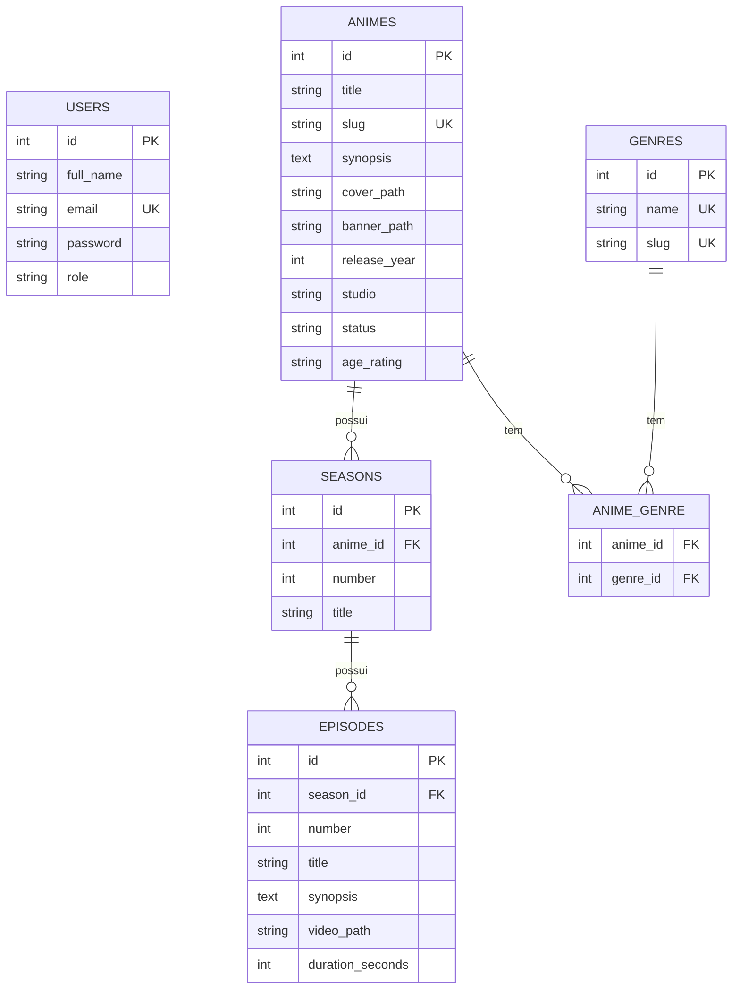

# Banco de dados

PostgreSQL 17, rodando no Docker (ver `docker-compose.yml`).

## Diagrama

## Relacionamentos

| Relacionamento        | Tipo | Implementação             |
| --------------------- | ---- | ------------------------- |
| Anime → Temporadas    | 1:N  | `seasons.anime_id`        |
| Temporada → Episódios | 1:N  | `episodes.season_id`      |
| Anime ↔ Gêneros       | N:N  | Tabela pivô `anime_genre` |

## Regras

- `users.role`: `'user'` (padrão) ou `'admin'`
- `animes.status`: `'ongoing'` (em lançamento) ou `'finished'` (finalizado)
- `animes.age_rating`: `'L'`, `'10'`, `'12'`, `'14'`, `'16'` ou `'18'`
- Únicos: `animes.slug`, `genres.name`, `genres.slug`, (`anime_id`, `number`) em `seasons`, (`season_id`, `number`) em `episodes`, (`anime_id`, `genre_id`) em `anime_genre`
- Ao remover um anime, suas temporadas, episódios e gêneros associados são removidos em cascata (`ON DELETE CASCADE`)
- Todas as tabelas, exceto `anime_genre`, possuem `created_at` e `updated_at`
